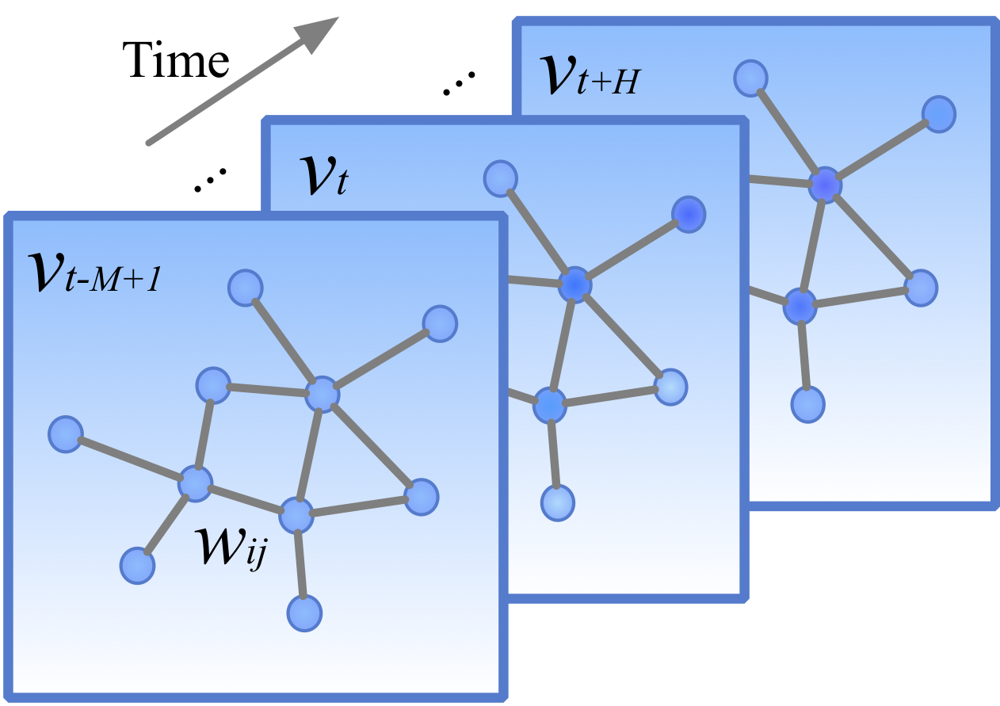
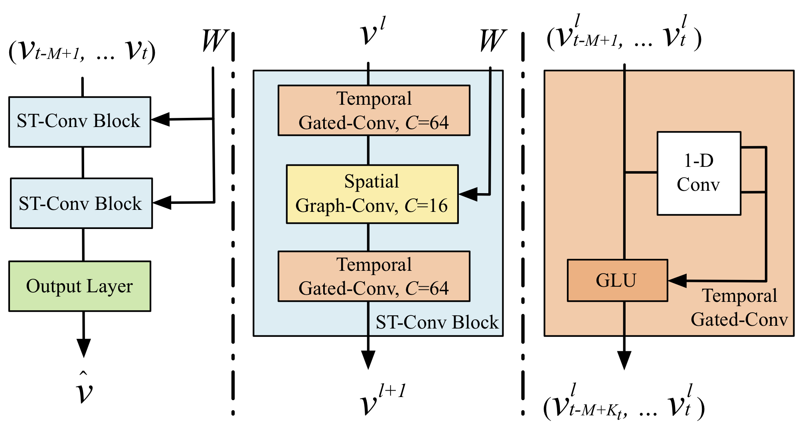
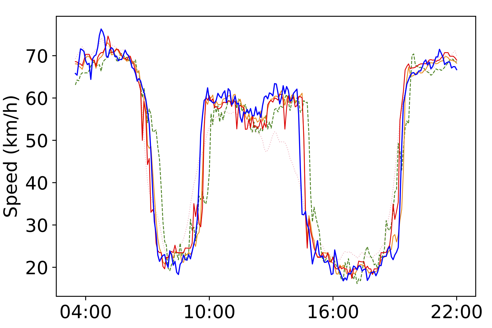
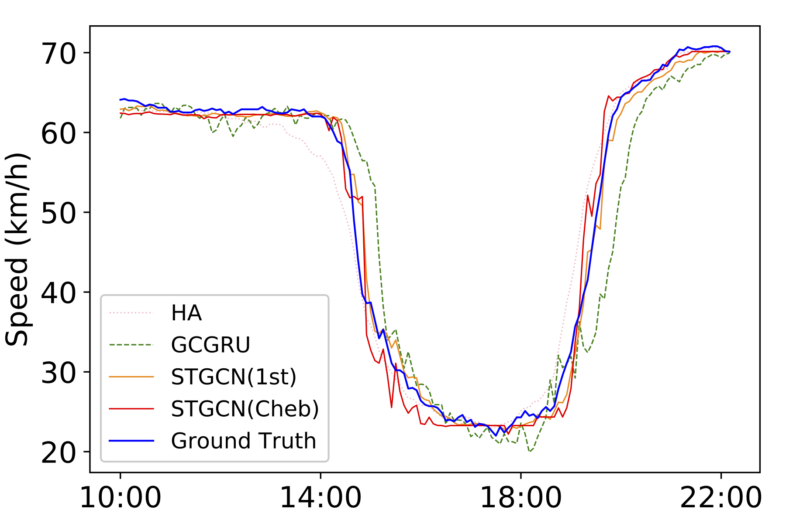
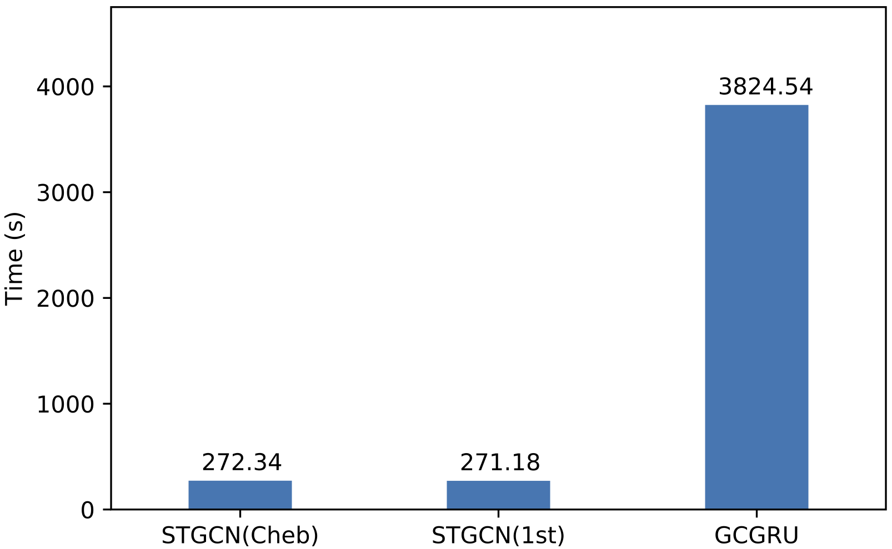
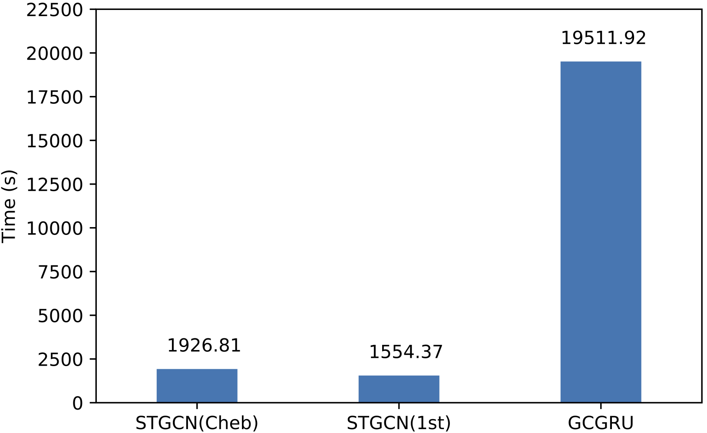

<h1 align="center"><ins>S</ins>patio-<ins>T</ins>emporal <ins>G</ins>raph <ins>C</ins>onvolutional <ins>N</ins>etworks: <br> A Deep Learning Framework for Traffic Forecasting</h1>
<p align="center">
    <a href="https://www.ijcai.org/proceedings/2018/0505.pdf"></a>
    <a href="https://github.com/VeritasYin/STGCN_IJCAI-18"></a>
    <a href="https://github.com/VeritasYin/STGCN_IJCAI-18/blob/master/LICENSE"></a>
    <a href="https://pytorch-geometric-temporal.readthedocs.io/en/latest/modules/root.html#torch_geometric_temporal.nn.attention.stgcn.STConv"></a>
    <a href="https://github.com/VeritasYin/STGCN_IJCAI-18/stargazers"></a>
    <a href="https://github.com/VeritasYin/STGCN_IJCAI-18/network/members"></a>
</p>

## Introduction 
We propose a novel deep learning framework, **STGCN**, to tackle time series prediction problem in traffic domain. Instead of applying regular convolutional and recurrent units, we formulate the problem on graphs and build the model with complete convolutional structures. To the best of our knowledge, it is the first time that to apply purely convolutional structures to extract spatio-temporal features simultaneously from graph-structured time series in a traffic study. 

**Navigation:** [Getting Started](#getting-started) • [Methodology](#methodology) • [Experimental Results](#experimental-results) • [Updates](#updates) • [Citation & Extras](#citation--extras)

## Getting Started

**1. Installation**  
Our code is based on Python3 (>= 3.6). We recommend using `virtualenv` or `conda` to manage the dependencies.
```bash
git clone https://github.com/VeritasYin/STGCN_IJCAI-18.git
cd STGCN_IJCAI-18
pip install -r requirements.txt
```

**2. Dataset Preparation**  
**[PeMSD7](http://pems.dot.ca.gov/)** was collected from Caltrans Performance Measurement System (PeMS) in real-time by over 39, 000 sensor stations, deployed across the major metropolitan areas of California state highway system. The time range of the dataset is the weekdays of **May and June of 2012**. We select the first month of historical speed records as training set, and the rest serves as validation and test set respectively.

Dataset PeMSD7(M/L) is now available under the `dataset` folder (**station list included**). Please refer to [issue #6](https://github.com/VeritasYin/STGCN_IJCAI-18/issues/6) for how to download metadata from PeMS. 

You can make your customized dataset by the following format:  
- `PeMSD7_V_{$num_route}.csv` : Historical Speed Records with shape of [len_seq * num_road] (len_seq = day_slot * num_dates).
- `PeMSD7_W_{$num_route}.csv` : Weighted Adjacency Matrix with shape of [num_road * num_road].
*(Note: replace `$num_route` with the number of routes in your dataset. '*.csv' should not contain any index or header.)*

The standard time interval is set to 5 minutes. Thus, every node of the road graph contains **288** data points per day (day_slot = 288). The linear interpolation method is used to fill missing values after data cleaning. In addition, data inputs are normalized by the Z-Score method. All of our experiments use 60 minutes as the historical time window, a.k.a. 12 observed data points (M = 12) are used to forecast traffic conditions in the next 15, 30, and 45 minutes (H = 3, 6, 9).

**3. Alternative Implementations**  
The implementation of Spatio-Temporal Graph Convolutional Layer with PyTorch is available in [PyG Temporal](https://github.com/benedekrozemberczki/pytorch_geometric_temporal/blob/master/torch_geometric_temporal/nn/attention/stgcn.py). You might refer to [STConv](https://pytorch-geometric-temporal.readthedocs.io/en/latest/modules/root.html#temporal-graph-attention-layers) that supports ChebConv Graph Convolutions.

**4. Training**  
Run the training script via:
```bash
python main.py --n_route {$num_route} --graph {$weight_matrix_file} 
```
**Default settings**:  
* **Configs**: `n_route=228`, `graph='default'`, `ks=3`, `kt=3`, `n_his=12`, `n_pred=9`, `batch_size=50`, `epoch=50`, `lr=0.001`, `opt='RMSProp'`, `inf_mode='merge'`, `save=10`. 
* Data sources will be searched in `dataset_dir = './dataset'`. Trained models will be saved in `save_path = './output/models'` every 10 epochs. Training logs will be saved in `sum_path = './output/tensorboard'`.

## Methodology

**Problem Formulation**  
Traffic forecast is a typical time-series prediction problem, i.e. predicting the most likely traffic measurements (e.g. speed or traffic flow) in the next $H$ time steps given the previous $M$ observations from traffic network $G$ as, 

$$
\hat{v}_{t+1}, \dots, \hat{v}_{t+H} = \arg \max_{v_{t+1}, \dots, v_{t+H}} \log P(v_{t+1}, \dots, v_{t+H} \mid v_{t-M+1}, \dots, v_t; G)
$$
  
<p align="center"></p> 
  
**Fig.1 Graph-structured traffic data.** Each $v_t$ indicates a frame of current traffic status at time step $t$, which is recorded in a graph-structured data matrix.

In PeMSD7, the weighted adjacency matrix $W$ of the road graph is computed based on the distances among stations:

$$
w_{ij} = 
\begin{cases} 
\exp \left(-\frac{d_{ij}^2}{\sigma^2}\right), & i \neq j \text{ and } \exp \left(-\frac{d_{ij}^2}{\sigma^2}\right) \geq \epsilon \\ 
0, & \text{otherwise} 
\end{cases}
$$

**Neural Network Structure**  
<p align="center"></p>
  
**Fig. 2 Architecture of spatio-temporal graph convolutional networks.** The framework STGCN consists of two spatio-temporal convolutional blocks (ST-Conv blocks) and a fully-connected output layer in the end. Each ST-Conv block contains two temporal gated convolution layers and one spatial graph convolution layer in the middle. The residual connection and bottleneck strategy are applied inside each block. The input $v_{t-M+1}, ..., v_t$ is uniformly processed by ST-Conv blocks to explore spatial and temporal dependencies coherently. Comprehensive features are integrated by an output layer to generate the final prediction $\hat{v}$. 

## Experimental Results  
|      Model      |                    | PeMSD7(M) (15/30/45 min) |                    |                    | PeMSD7(L) (15/30/45 min) |                    |
|:---------------:|:------------------:|:------------------------:|:------------------:|:------------------:|:------------------------:|:------------------:|
|        /        |         MAE        |          MAPE(%)         |        RMSE        |         MAE        |          MAPE(%)         |        RMSE        |
|        HA       |        4.01        |           10.61          |        7.20        |        4.60        |           12.50          |        8.05        |
|       LSVR      |   2.50/3.63/4.54   |      5.81/8.88/11.50     |   4.55/6.67/8.28   |   2.69/3.85/4.79   |      6.27/9.48/12.42     |   4.88/7.10/8.72   |
|      ARIMA      |   5.55/5.86/6.27   |     12.92/13.94/15.20    |   9.00/9.13/9.38   |   5.50/5.87/6.30   |     12.30/13.54/14.85    |   8.63/8.96/9.39   |
|       FNN       |   2.74/4.02/5.04   |      6.38/9.72/12.38     |   4.75/6.98/8.58   |   2.74/3.92/4.78   |     7.11/10.89/13.56     |   4.87/7.02/8.46   |
|     FC-LSTM     |   3.57/3.94/4.16   |      8.60/9.55/10.10     |   6.20/7.03/7.51   |   4.38/4.51/4.66   |     11.10/11.41/11.69    |   7.68/7.94/8.20   |
|      GCGRU      |   2.37/3.31/4.01   |      5.54/8.06/9.99      |   4.21/5.96/7.13   |  2.48/3.43/4.12∗  |     5.76/8.45/10.51∗    |  4.40/6.25/7.49∗  |
| **STGCN(Cheb)** | **2.25/3.03/3.57** |    5.26/**7.33/8.69**    | **4.04/5.70/6.77** | **2.37/3.27/3.97** |    **5.56/7.98/9.73**    | **4.32/6.21/7.45** |
|  **STGCN(1st)** |   2.26/3.09/3.79   |    **5.24**/7.39/9.12    |   4.07/5.77/7.03   |   2.40/3.31/4.01   |      5.63/8.21/10.12     |   4.38/6.43/7.81   |
  
**Table 1: Performance comparison of different approaches on the dataset PeMSD7.**
  
<p align="center"></p>
  
**Fig. 3: Speed prediction in the morning peak and evening rush hours of the dataset PeMSD7.**
  
<p align="center"></p>
  
**Fig. 4: Time consumptions of training on the dataset PeMSD7 (M, left) and (L, right)**

## Updates
* **Jun. 13, 2026**: Released explicit station lists for PeMSD7-L (1,026 nodes).
* **Feb. 22, 2022**: Sensor Station List of PeMSD7-M released.
* **Feb. 11, 2022**: Dataset PeMSD7-L (1,026 nodes) released. Fix the issue in size calculation of temporal channel. Thanks to @KingWang93 and @cheershuaizhao.
* **Apr. 18, 2019**: Dataset PeMSD7-M (228 nodes) released.
* **Jan. 14, 2019**: Code refactoring based on the [Tensorflow-Project-Template](https://github.com/MrGemy95/Tensorflow-Project-Template); added `model_save()`, `model_test()`, and tensorboard support.

## Citation & Extras

**Citation**  
Please refer to our paper: Bing Yu*, Haoteng Yin*, Zhanxing Zhu. [Spatio-temporal Graph Convolutional Networks: A Deep Learning Framework for Traffic Forecasting](https://www.ijcai.org/proceedings/2018/0505). In *Proceedings of the 27th International Joint Conference on Artificial Intelligence (IJCAI)*, 2018.
```bibtex
@inproceedings{yu2018spatio,
    title={Spatio-temporal Graph Convolutional Networks: A Deep Learning Framework for Traffic Forecasting},
    author={Yu, Bing and Yin, Haoteng and Zhu, Zhanxing},
    booktitle={Proceedings of the 27th International Joint Conference on Artificial Intelligence (IJCAI)},
    year={2018}
}
```

**License**  
This project is licensed under the BSD 2-Clause License - see the [LICENSE](LICENSE) file for details.

**Star History**  
  <a href="https://star-history.dera.page/#VeritasYin/STGCN_IJCAI-18&Date">
    <picture>
      <source media="(prefers-color-scheme: dark)" srcset="https://star-history.dera.page/svg?repos=VeritasYin/STGCN_IJCAI-18&type=Date&theme=dark" />
      <source media="(prefers-color-scheme: light)" srcset="https://star-history.dera.page/svg?repos=VeritasYin/STGCN_IJCAI-18&type=Date" />
      
    </picture>
  </a>